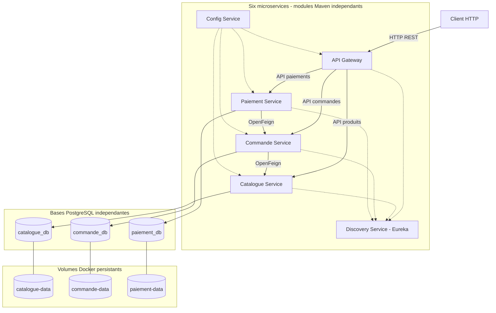

# Architecture apres migration

## Schema

## Description

Le projet est organise en six modules Maven independants.
Chaque microservice possede son propre pom.xml et son Dockerfile.

La Gateway constitue le point entree des requetes HTTP.
Eureka permet la decouverte des services.
Config Server fournit la configuration centralisee.

Le service Commande consulte Catalogue avec OpenFeign.
Le service Paiement consulte Commande avec OpenFeign.

Chaque service metier possede sa propre base PostgreSQL.
Les donnees sont conservees dans trois volumes Docker distincts.

Docker Compose permet de demarrer les neuf conteneurs.
Des healthchecks permettent de verifier leur etat.

## Ameliorations par rapport a architecture initiale

- Six modules Maven autonomes au lieu du projet Maven unique.
- Une base PostgreSQL par service metier.
- Des images Docker propres a chaque microservice.
- Un deploiement commun avec Docker Compose.
- Des tests automatises et des controles de sante.
