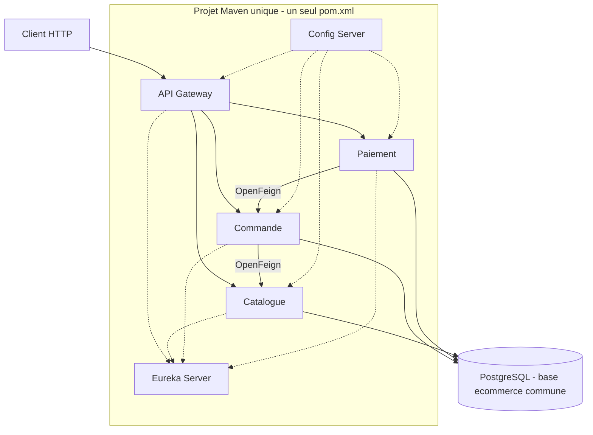

# Architecture avant migration

## Schema

## Description

L'architecture initiale regroupait six applications Spring Boot dans un seul projet Maven.
Chaque application disposait de sa propre classe principale et de son profil Spring.
Les trois services metier utilisaient une base PostgreSQL commune.
Eureka assurait la decouverte des services et Config Server centralisait la configuration.
Les appels entre services utilisaient OpenFeign.

## Limites

- Un seul projet Maven pour les six applications.
- Une base de donnees partagee entre les trois services metier.
- Une autonomie limitee pour la compilation et la gestion des dependances.
